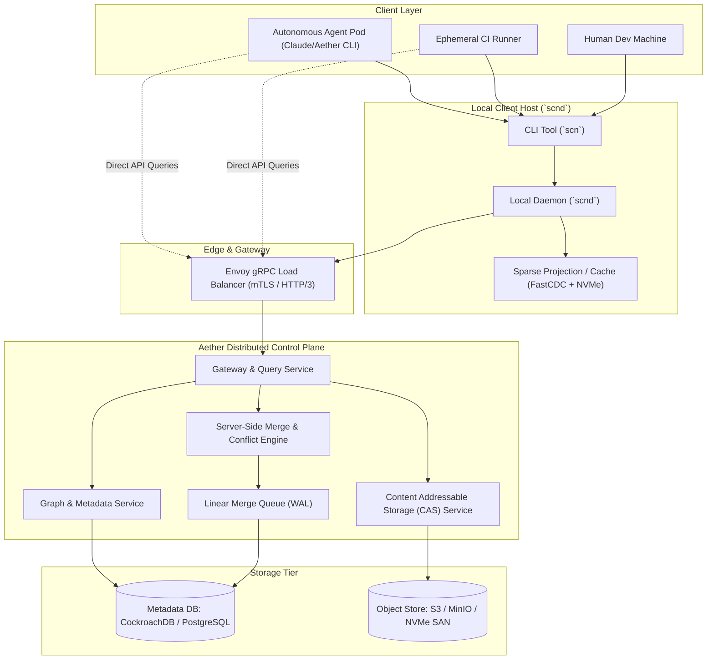
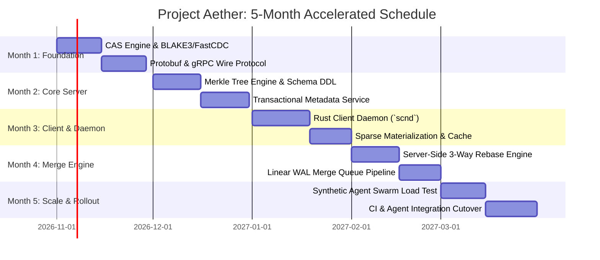

# Product Requirements Document (PRD): Scion-Class Version Control System

**Project Codename:** Project Aether (Agent-Scale Source Control)  
**Document Status:** Approved / Ready for Engineering  
**Target Release:** 5-Month Accelerated Delivery Track  
**Architectural Reference:** Anthropic *Scion* & Google *Piper* / Meta *Sapling*  

---

## 1. Executive Summary & Problem Definition

### 1.1 Context
In organizations operating autonomous AI coding agents (such as Claude Code, SWE-agents, and automated research loops), software engineering velocity transitions from human-scale to machine-scale. At this inflection point:
* Daily pull requests scale from thousands to **30,000+ merges per day**.
* Continuous Integration (CI), automated test runners, and ephemeral agent containers execute **25,000,000+ checkouts daily**.
* Monorepo scale exceeds 100 GB in history, with single compressed worktrees exceeding 25–50 GB.

### 1.2 The Failure Modes of Traditional Git
Git was designed in 2005 for decentralized, human-driven development on the Linux kernel. It relies on four fundamental assumptions that break at agent scale:

| Git Assumption | Agent Reality | Failure Mode at Scale |
| :--- | :--- | :--- |
| **Decentralized / Offline-First** | 99.9% of clients are CI runners and containerized AI agents connected to high-bandwidth internal VPCs. | Forcing full local repository clones wastes petabytes of bandwidth. Attempting 25M daily clones would move >600 PB/day. |
| **Client-Side Heavy Compute** | Merges, rebases, blames, and commit graph calculations are done by the client machine. | High CPU/RAM overhead on ephemeral agent pods; severe cache thrashing and slow initialization times. |
| **Snapshot Trees & Packfiles** | Commits store entire tree snapshots; periodic git GC rewrites packfiles. | Massive disk I/O, repack lock contention, and high server memory overhead under 30,000 writes/day. |
| **Global Ref Contention** | Branches and tags are global refs updated via mutual exclusion locks (`refs/heads/*`). | Pushing to shared tip causes cascading lock retries and rejection storm during high merge rates. |

### 1.3 Project Goal
Build **Project Aether**: an open-source, enterprise-grade, server-centric, API-first version control system optimized for autonomous AI coding agents and hyper-scale monorepos. It must reduce infrastructure footprint by 200x compared to Git mirrors, slash checkout times from minutes to sub-second / single-digit seconds, and sustain 50,000+ linear commits per day without global lock contention.

---

## 2. Core Architectural Principles

1. **Always-Online Assumption:** Discard offline history replication. Every client operates over reliable, low-latency network connections.
2. **Client-Server Asymmetry:** Offload 95% of compute (history graph traversal, tree diffs, 3-way merges, rebases, and blame) to horizontally scalable backend services. The client is a thin, caching filesystem supervisor.
3. **API-First Source Control:** Expose every repository operation as a low-latency gRPC/Protobuf API. Agents and CI jobs query file slices, AST nodes, and diffs programmatically without materializing full directory trees.
4. **Zero Packfiles & Zero Maintenance:** Store deduplicated content-addressed blobs in distributed object storage (S3/GCS/MinIO) and commit graphs in a distributed transactional SQL/KV engine (CockroachDB/Postgres). No repack loops; no downtime garbage collection.
5. **Lock-Free Server-Side Change Management:** "Pushing" is replaced by submitting server-side changesets. Changesets are merged via speculative rebase pipelines, eliminating branch lock contention.
6. **On-Demand & Sparse Materialization:** Client workspaces only fetch and mount file trees explicitly requested by the agent or touched during execution.

---

## 3. High-Level System Architecture



---

## 4. Component Specifications

### 4.1 Client Tooling: CLI (`scn`) and Daemon (`scnd`)
* **Technology:** Rust (Zero GC pauses, low memory footprint, native POSIX/Windows IO).
* **CLI (`scn`):** Provides user- and agent-facing commands (`scn checkout`, `scn status`, `scn change`, `scn submit`, `scn query`).
* **Daemon (`scnd`):**
  * Runs as a background service on developer workstations, agent pods, and CI nodes.
  * Maintains a fixed-size local blob cache (e.g., 20 GB LRU on NVMe).
  * Manages sparse materialization: only files matching an agent's configured scope (or touched in run time) are pulled.
  * Filesystem monitoring via native kernel hooks (`inotify` on Linux, `FSEvents` on macOS).
  * Direct gRPC streaming connection to the server cluster with connection multiplexing.

### 4.2 Content Addressable Storage (CAS) Service
* **Deduplication:** Fast Content-Defined Chunking (FastCDC, 16KB–64KB target chunk size) for files > 128KB. Small files stored as single blobs.
* **Hashing:** BLAKE3-256 for maximum cryptographically secure hashing speed (>5 GB/s per core).
* **Compression:** Zstandard (zstd) level 3 for streaming chunks over the wire; compressed at rest.
* **Backing Store:** Horizontally scalable object storage (AWS S3, Google Cloud Storage, or MinIO clusters) fronted by server-side memory/NVMe read-through caches.

### 4.3 Metadata & Commit Graph Service
* **Graph Model:** Directed Acyclic Graph (DAG) of Changesets stored in relational tables with precomputed topological indexes.
* **Database:** CockroachDB or clustered PostgreSQL with multi-region read replicas.
* **Tree Representation:** Merkle Tree where directory nodes contain sorted arrays of `(mode, name, child_hash, subtree_size)`. Child hashes are BLAKE3 digests of subtrees or blob manifests.
* **Zero Packfile Overhead:** Trees and commits are row records and small object store payloads, directly queryable without uncompressing multi-gigabyte packfiles.

### 4.4 Server-Side Merge & Rebase Engine
* **Automated Rebase:** When an agent submits a changeset against revision $N$, but main has advanced to $N + k$, the server computes a 3-way tree diff and attempts a fast, non-conflicting rebase entirely in RAM without client roundtrips.
* **Semantic & AST Merging:** Pluggable AST-aware merge drivers (Tree-sitter) for common languages (Python, TypeScript, Rust, Go) to resolve import ordering and non-overlapping structural edits automatically.
* **Failure Routing:** If conflicts occur, the server generates a structured conflict description payload sent back to the agent session for programmatic resolution.

### 4.5 High-Throughput Merge Queue ("Landing Engine")
* **Continuous Linearization:** All changes destined for `main` enter a deterministic Write-Ahead Log (WAL) merge queue.
* **Speculative Execution:** Changesets are tested in parallel speculative batches (e.g., Change A, Change A+B, Change A+B+C) to achieve high throughput without serial bottlenecking.
* **Guaranteed Linearity:** `main` remains strictly linear (or semi-linear), eliminating merge bubbles and simplifying bisecting and revert workflows.

---

## 5. Data Model & Storage Schema

### 5.1 Object Types

#### 1. Blob
```protobuf
message BlobChunk {
  bytes hash = 1;        // BLAKE3 hash of uncompressed chunk (32 bytes)
  uint32 size = 2;       // Uncompressed byte size
  bytes data = 3;        // Compressed data payload (zstd)
}

message BlobManifest {
  bytes blob_hash = 1;         // BLAKE3 of entire file
  uint64 total_size = 2;       // Total file length
  repeated bytes chunk_hashes = 3; // Ordered list of chunk hashes
}
```

#### 2. Tree Node
```protobuf
message TreeEntry {
  enum FileMode {
    REGULAR = 0;
    EXECUTABLE = 1;
    SYMLINK = 2;
    DIRECTORY = 3;
  }
  FileMode mode = 1;
  string name = 2;
  bytes hash = 3;        // BLAKE3 hash of child Tree or BlobManifest
  uint64 size = 4;       // Size of subtree or file
}

message Tree {
  bytes tree_hash = 1;
  repeated TreeEntry entries = 2; // Alphabetically sorted by name
}
```

#### 3. Changeset / Commit
```protobuf
message Changeset {
  bytes changeset_id = 1;       // BLAKE3(parents + tree_hash + author + timestamp + nonce)
  repeated bytes parent_ids = 2;
  bytes root_tree_hash = 3;
  string author = 4;
  string message = 5;
  int64 timestamp_utc = 6;
  
  // Agent provenance metadata
  string agent_model = 7;      // e.g., "claude-code-3.7-sonnet"
  string session_id = 8;       // Execution context UUID
  string task_trace_id = 9;    // Link to agent prompt/trajectory
}
```

### 5.2 Relational Database Schema (SQL DDL)

```sql
CREATE TABLE repositories (
    repo_id UUID PRIMARY KEY,
    name VARCHAR(255) UNIQUE NOT NULL,
    created_at TIMESTAMPTZ NOT NULL DEFAULT NOW()
);

CREATE TABLE branches (
    repo_id UUID NOT NULL,
    branch_name VARCHAR(255) NOT NULL,
    head_changeset_id BYTEA NOT NULL,
    sequence_number BIGINT NOT NULL,
    updated_at TIMESTAMPTZ NOT NULL DEFAULT NOW(),
    PRIMARY KEY (repo_id, branch_name)
);

CREATE TABLE changesets (
    changeset_id BYTEA PRIMARY KEY,
    repo_id UUID NOT NULL REFERENCES repositories(repo_id),
    sequence_number BIGINT, -- Non-null for changesets merged to main
    root_tree_hash BYTEA NOT NULL,
    parent_ids BYTEA[] NOT NULL,
    author VARCHAR(255) NOT NULL,
    message TEXT NOT NULL,
    agent_model VARCHAR(100),
    session_id UUID,
    created_at TIMESTAMPTZ NOT NULL DEFAULT NOW()
);

CREATE INDEX idx_changesets_sequence ON changesets(repo_id, sequence_number DESC) 
    WHERE sequence_number IS NOT NULL;

CREATE TABLE sparse_profiles (
    profile_id UUID PRIMARY KEY,
    repo_id UUID NOT NULL,
    name VARCHAR(100) NOT NULL,
    included_patterns TEXT[] NOT NULL, -- e.g., ["services/auth/**", "shared/proto/**"]
    created_at TIMESTAMPTZ NOT NULL DEFAULT NOW()
);
```

---

## 6. Communication Protocols & gRPC API Specifications

The communication between `scn`/`scnd` and the backend cluster is fully multiplexed over gRPC/HTTP/3.

```protobuf
syntax = "proto3";
package aether.v1;

service SourceControlService {
  // Query metadata without checkout
  rpc GetChangeset(GetChangesetRequest) returns (Changeset);
  rpc QueryPathHistory(QueryPathHistoryRequest) returns (PathHistoryResponse);
  rpc GetFileBlame(GetFileBlameRequest) returns (FileBlameResponse);
  rpc DiffTrees(DiffTreesRequest) returns (DiffTreesResponse);

  // Sparse Materialization & Object Streaming
  rpc GetTreeRecursive(GetTreeRecursiveRequest) returns (stream TreeChunk);
  rpc BatchGetBlobs(BatchGetBlobsRequest) returns (stream BlobChunk);

  // Mutation & Agent Landing
  rpc CreateDraftChangeset(CreateDraftChangesetRequest) returns (DraftResponse);
  rpc SubmitChangeset(SubmitChangesetRequest) returns (SubmitResponse);
  rpc ResolveConflict(ResolveConflictRequest) returns (SubmitResponse);
}

message GetTreeRecursiveRequest {
  bytes root_tree_hash = 1;
  repeated string path_patterns = 2; // Sparse filters: e.g. ["infra/k8s/*", "core/lib/*"]
  uint32 max_depth = 3;
}

message BatchGetBlobsRequest {
  repeated bytes chunk_hashes = 1;
}

message SubmitChangesetRequest {
  bytes repo_id = 1;
  bytes base_changeset_id = 2;
  bytes new_tree_hash = 3;
  string message = 4;
  string author = 5;
  string agent_session_id = 6;
  bool auto_rebase = 7;
}

message SubmitResponse {
  enum Status {
    MERGED = 0;
    QUEUED_IN_MERGE_PIPELINE = 1;
    REBASE_CONFLICT = 2;
    VALIDATION_FAILED = 3;
  }
  Status status = 1;
  bytes final_changeset_id = 2;
  uint64 sequence_number = 3;
  repeated string conflict_files = 4;
  string error_message = 5;
}
```

---

## 7. Client Daemon (`scnd`) & Sparse Checkout Workflow

### 7.1 Workspace Initialization
When an autonomous agent spins up a sandbox:
1. Agent invokes: `scn clone --sparse-profile backend-unit <repo-url> <target-dir>`
2. Instead of downloading 100 GB history:
   - `scnd` issues an RPC `GetChangeset(head_of_main)` (takes 10ms).
   - `scnd` fetches only the directory structure of files matching `backend-unit` (takes 150ms).
   - Virtual or sparse files are laid out on disk.
   - Total time to ready state: **< 1.5 seconds** (compared to 15+ minutes with Git).

### 7.2 Read-Through On-Demand Fetching
If an agent unexpectedly accesses an unpopulated file:
1. The daemon intercepts the path access or the agent calls `scn fetch-path <path>`.
2. Daemon requests the tree node and blob chunks from the CAS cluster via gRPC.
3. Chunks are cached in local NVMe storage and materialized instantly.

### 7.3 Committing & Landing
When the agent finishes its edit:
1. Agent runs: `scn commit -m "fix(auth): update token expiration check"`
2. `scnd` computes local dirty files via `inotify` changes, creates local BLAKE3 hashes of modified files, and uploads *only* new blobs to CAS.
3. `scnd` constructs the new Merkle tree root hash and sends `SubmitChangesetRequest` to the server.
4. Server's Merge Queue rebases the change onto `main`'s latest revision, executes lightweight validation, updates the `main` branch pointer atomically, and returns the landed commit ID.

---

## 8. Performance SLAs & Metrics

| Metric | Git Baseline (Large Monorepo) | Project Aether Target | Verification Method |
| :--- | :--- | :--- | :--- |
| **New Agent Pod Checkout Time** | 4 – 15 minutes | **< 2.5 seconds** (p99) | Benchmark 5,000 parallel container starts |
| **Commit to Landed in `main`** | 30s – 5 minutes (PR + merge + push) | **< 3.0 seconds** (p95) | Load test at 400 concurrent submissions/sec |
| **Infrastructure Compute Footprint** | Hundreds of read-mirrors, high CPU | **200x reduction** | CPU core and RAM allocation audit |
| **Network Egress per Checkout** | 25 GB – 100 GB (clone/fetch) | **< 25 MB** (sparse) | Cloud VPC traffic accounting |
| **Supported Daily Merges** | ~2,500/day before lock congestion | **50,000+ daily merges** | Synthetic agent swarm simulation |

---

## 9. 5-Month Engineering Implementation Roadmap



### Detailed Monthly Deliverables

#### Month 1: Storage Layer & Network Primitives
* Implement CAS blob chunking engine in Rust/Go using FastCDC and BLAKE3.
* Object storage adapters for AWS S3 and MinIO with zstd compression pipelines.
* Complete Protobuf API contracts for `SourceControlService`.

#### Month 2: Metadata & Tree Service
* Stand up distributed transactional database (CockroachDB / Postgres) with relational schema.
* Implement Merkle Tree calculation and traversal algorithms.
* API endpoints for fast recursive tree queries and tree diffs.

#### Month 3: Client CLI (`scn`) & Daemon (`scnd`)
* Build the Rust `scnd` daemon with in-memory LRU and NVMe disk caching.
* Implement sparse working copy manager with manifest-based file laying.
* Add filesystem change detection (`inotify` / `FSEvents`) to track modified agent files.

#### Month 4: Server-Side Merge & Merge Queue
* Build server-side non-conflicting rebase engine.
* Integrate Tree-sitter AST merge drivers for structural conflict resolution.
* Implement continuous speculative merge queue for linear `main` branch progression.

#### Month 5: Verification, Benchmarking & Tooling Integration
* Run synthetic load test simulating 30,000 daily changesets and 10,000 concurrent agent checkouts.
* Integrate with Claude Code / autonomous agent runners via direct SDK and CLI bindings.
* Provide an internal code review bridge for automated human/agent sign-off.
* Configure automated deployment pipelines using Render CLI for backend control plane services and Vercel CLI for the web review dashboard.

---

## 10. Security, Governance & Auditability

1. **Cryptographic Integrity:** Every object is uniquely identified by its BLAKE3 hash. Tree roots guarantee complete tamper resistance from leaf blob to root commit.
2. **mTLS & Ephemeral Identity:** Agent pods authenticate via short-lived SPIFFE/SPIRE x509 certificates or OIDC identity tokens injected into the container environment.
3. **Autonomous Agent Provenance:** Every changeset record includes immutable audit metadata linking the commit to the specific AI model name, prompt context hash, session ID, and verification test logs.
4. **Access Control:** Path-level ACLs enforced at the server API layer during sparse tree queries, preventing unauthorized agents from fetching sensitive subtrees.

---

## 11. Deployment Strategy (Render & Vercel CLIs)

The system adopts a bifurcated deployment model using dedicated developer cloud CLIs to enable instant continuous delivery for both backend services and the frontend review ecosystem:

### 11.1 Backend Control Plane & Microservices: Render CLI
* **Target Services:**
  * `aether-api-gateway` (gRPC/HTTP/3 routing service).
  * `aether-merge-engine` (background merge queue, rebase worker, WAL processor).
  * `aether-metadata-service` (CockroachDB/Postgres connector).
* **CLI Deployment Automation:**
  * Managed via Infrastructure as Code through `render.yaml` blueprints.
  * Automated deployments triggered via Render CLI in CI/CD:
    ```bash
    # Authenticate and deploy blueprint services
    render login --api-key $RENDER_API_KEY
    render blueprints launch --blueprint ./infra/render.yaml
    render deploys create srv-<service-id> --wait
    ```
  * Health check endpoints: `/healthz` exposed via HTTP/1.1 sidecar for Render load balancer health monitoring.

### 11.2 Web Console & Code Review Platform ("Antique"): Vercel CLI
* **Target Services:**
  * Next.js / React web dashboard for inspecting changesets, visual tree browsing, and agent run reviews.
  * Serverless Edge API middleware for lightweight public REST queries.
* **CLI Deployment Automation:**
  * Deployed strictly using the Vercel CLI (`vercel`) for preview and production environments:
    ```bash
    # Pull production environment variables
    vercel env pull .env.production.local --token=$VERCEL_TOKEN

    # Ephemeral preview deployment for agent changeset validation
    vercel deploy --token=$VERCEL_TOKEN

    # Production release deployment on linear main landing
    vercel deploy --prod --token=$VERCEL_TOKEN
    ```
* **Preview Environments for Agents:**
  * When an agent submits a changeset that includes frontend UI modifications, the CI runner uses `vercel deploy` to generate an isolated preview URL, embedding the link directly into the changeset review metadata.

